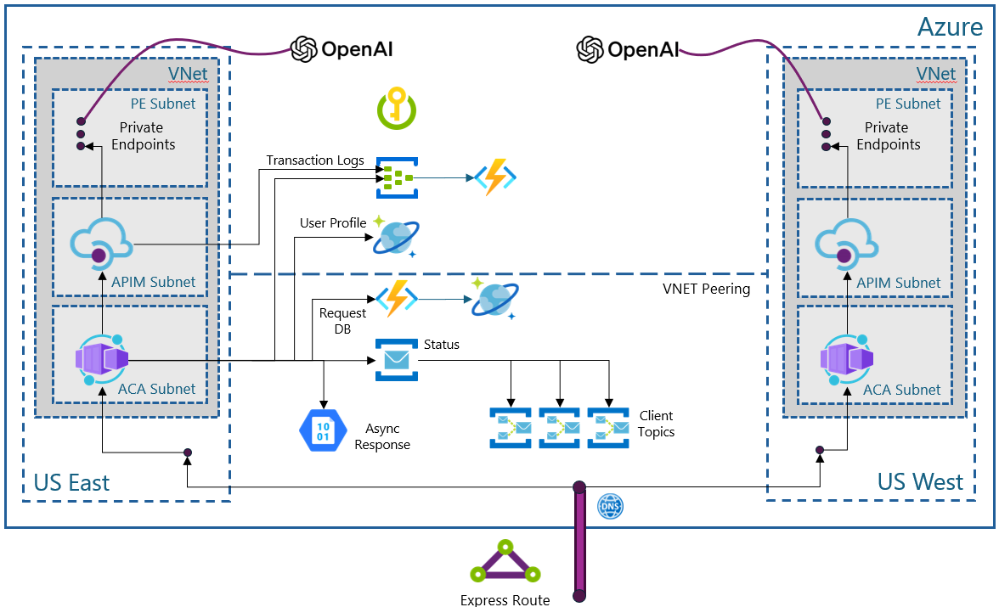

# SimpleL7Proxy — Overview

| | |
|---|---|
| **Version** | 1.1 |
| **Last Updated** | 2026-05-21 |
| **Owner** | Platform Engineering |
| **Status** | Active |

---

## Overview Summary

SimpleL7Proxy is a self-hosted, open-source Layer 7 proxy for Azure AI workloads. It sits between client applications and backend model endpoints, providing request governance, priority queuing, load balancing, fault isolation, async request handling, and per-request telemetry.

The proxy addresses a structural gap in AI platform deployments: when multiple clients with different latency and throughput requirements share a fixed pool of model backends, standard HTTP infrastructure provides no mechanism to enforce fairness, isolate failures, absorb long-running requests, or extract token-level telemetry from streaming responses. SimpleL7Proxy fills that gap as a self-hosted, operator-owned data-plane component that runs entirely within the operator's infrastructure.

> Need help diagnosing issues quickly? Start at [TroubleshootTOC.md](../troubleshooting/README.md).

---

## Key Objectives

| Objective | Mechanism |
|-----------|-----------|
| Prioritize interactive requests over batch workloads | Priority queue with preferred worker priorities |
| Favor requests from users with a smaller active share | Secondary queue preference based on each user's tracked share; no cap or rejection |
| Isolate backend failures from client impact | Per-backend circuit breakers with automatic recovery; cross-host retry within TTL budget |
| Handle AI tasks that exceed synchronous HTTP timeouts | Eligible async requests can receive 202 after the configured trigger; processing continues in the background and results are stored in Azure Blob Storage |
| Provide per-request token telemetry | Configured response processors extract supported JSON or SSE usage; usage may be unavailable |
| Enable live operational changes without container restart | Warm settings reload via Azure App Configuration; settings captured at startup still require restart |
| Run within operator-controlled infrastructure with no external data dependencies | Self-hosted container; Managed Identity for all Azure service authentication |

### Well-Architected Framework Alignment

Show WAF pillar mapping

| Pillar | How the proxy contributes |
|--------|--------------------------|
| **Reliability** | Per-backend circuit breakers with automatic recovery, cross-host retry, requeue on over-capacity, TTL expiry to shed stale work, health endpoints for orchestration platforms. |
| **Security** | Caller identity validation before queuing, header stripping to prevent internal value leakage, per-user header allowlists, immediate user suspension without restart. |
| **Performance Efficiency** | Priority queue with preferred worker priorities, latency-ordered backend selection, and a per-user secondary queue preference. |
| **Operational Excellence** | Warm settings propagate live via Azure App Configuration; structured per-request telemetry to Application Insights and Event Hubs; sidecar isolates health checking from request traffic. |
| **Cost Optimization** | Per-request token telemetry from streaming responses enables per-user billing and chargeback; per-user throttling prevents runaway consumption; requeue preserves work rather than forcing client re-submission. |

---

## High-Level Architecture

SimpleL7Proxy is a single-process .NET service deployed as a container, typically within Azure Container Apps behind Azure API Management. The table below describes the major internal components and their roles.

| Component | Role |
|-----------|------|
| Listener | Accepts inbound HTTP connections and passes each request to the validation pipeline. |
| Validation Pipeline | Six ordered checks applied before a request enters the queue: inbound auth, App ID validation, header stripping, user profile load, required headers, and header value validation. |
| Priority Queue | In-memory sorted list ordered by priority tier using binary-search insertion; holds requests pending worker dispatch. |
| Worker Pool | Configurable thread pool that dequeues requests in priority order and drives backend selection and forwarding. |
| Backend Selection Pipeline | Resolves a named route or legacy path set, filters by `acceptablePriorities`, orders legacy hosts, and applies circuit-breaker gates. Named routes preserve configured host order. |
| Circuit Breaker (per host) | Sliding-window failure counter; opens on error spike, closes automatically on recovery. Open hosts are skipped without consuming the retry budget. |
| Async Engine | Can release an eligible request after its async trigger and continue the backend call in the background, subject to async configuration and queue pressure. |
| Event Fan-out | Serializes a structured event record per request and delivers it to all configured telemetry sinks simultaneously. |
| Health Endpoints | `/liveness`, `/readiness`, `/startup` for container orchestration probes. Optionally isolated in a sidecar container. |

**Deployment boundaries:** the proxy runs inside the operator's VNet. Backends are reached over the internal network or via Private Endpoints. Telemetry sinks are reached with Managed Identity authentication. An optional sidecar HealthProbe container isolates Kubernetes and Container Apps probe handling from proxy traffic load.

---

## Core Concepts

| Concept | Definition |
|---------|-----------|
| Priority Tier | Integer assigned to every request. Lower integer = higher dispatch precedence. Derived by mapping a request header value against a configured lookup table. |
| TTL (Time-to-Live) | Total wall-clock budget for a request from enqueue through all retry attempts. Expiry discards the request before it reaches any backend. |
| Active Pool | The set of backend hosts currently eligible for traffic, filtered by rolling probe success rate. |
| Circuit Breaker | Per-host failure counter with a sliding time window. Opens on error spike; closes automatically when failures age out. Open hosts are skipped in the selection pipeline. |
| User Profile | Per-user JSON object loaded on a configurable interval. Supplies per-user priority assignment, async configuration, and custom header injection. |
| Warm Setting | A configuration value stored in Azure App Configuration that reloads across proxy instances after the Sentinel key changes. Settings whose consumers snapshot values at startup, including `PriorityWorkers` and the active `UserPriorityThreshold`, still require a restart. |
| Cold Setting | A configuration value that takes effect only after a container restart. Used for foundational parameters such as worker count and async mode enable/disable. |
| Async Upgrade | The proxy returns 202 and continues processing in the background when async eligibility conditions are met and queue pressure allows the upgrade after the configured trigger. |
| ProxyEvent | A per-request structured record capturing HTTP status, queue duration, processing duration, backend identity, and token counts. Delivered to all configured telemetry sinks. |
| Token Telemetry | Usage extracted by the configured response processor. `Tokenomics` handles supported JSON and SSE usage, including cached-input and safety signals; usage may be unavailable when the response does not provide it. |
| Sentinel | A key in Azure App Configuration whose value change triggers hot-reload of all Warm settings across all running proxy instances. |

---

## High-Level Workflows

<h3>Synchronous request flow</h3>

1. Client sends an HTTP request to the proxy listener.
2. The validation pipeline screens the request: caller identity → header stripping → user profile load → required headers → header value allowlist. Rejected requests return 403 or 417.
3. The validated request enters the priority queue with a TTL clock and a priority tier derived from the caller's profile and request header.
4. A worker thread dequeues the request and runs backend selection: path filter → load-balance ordering → circuit-breaker gate.
5. The proxy forwards the request to the selected backend within the per-attempt timeout.
6. On a retriable error, the worker advances to the next host within the remaining TTL budget. On a 429 with the requeue signal, the request returns to the priority queue if the attempt cap has not been reached.
7. On success, the proxy appends timing and backend identity headers and returns the response to the client.
8. A structured event record is serialized and delivered to all configured telemetry sinks.

<h3>Async request flow</h3>

1. Steps 1–4 are identical to the synchronous flow.
2. If the request meets async eligibility conditions and queue pressure allows the upgrade, the proxy returns 202 Accepted after the configured trigger with the result blob URI in the response body.
3. Each backend attempt continues under `AsyncTimeout`; the request TTL is checked separately.
4. On completion, the result is written to Azure Blob Storage with a time-limited access token.
5. Lifecycle status events (queued, processing, completed, failed, expired) are emitted to the caller's dedicated Azure Service Bus topic throughout processing.
6. The result blob is retained for the configured period and then removed by a storage lifecycle policy.

<h3>Configuration hot-reload flow</h3>

1. An operator updates one or more Warm settings in Azure App Configuration.
2. The operator updates the Sentinel key to any new value.
3. All running proxy instances detect the Sentinel change within ~30 seconds and reload all Warm settings.
4. No container restart or redeployment is required. In-flight requests are unaffected.

<h3>Detailed behavioral walkthrough (expand for full narrative)</h3>

**Validation before the queue.** Every inbound request is screened before it can enter the queue. The proxy verifies the caller belongs to an approved identity list, strips headers that must not reach backends, loads the caller's user profile to apply per-user rules, and enforces that required headers are present and contain permitted values. A suspended caller is rejected immediately.

**Priority queue and time budget.** Requests that pass validation enter a priority queue. Each request is assigned a priority tier based on a header value — lower-priority callers such as batch jobs wait behind higher-priority ones such as interactive chat. Every request carries a time budget from enqueue; requests that wait too long are rejected rather than forwarded stale. Workers have preferred priority tiers. A per-user secondary queue preference favors users below their configured share of tracked active requests; it does not cap or reject requests.

**Backend selection pipeline.** When a worker picks up a request, it selects a backend through three steps: narrow the candidate list to hosts whose URL prefix matches the request path; order that list by the configured load-balance strategy (round-robin, latency-ordered, or random); then skip any host whose circuit breaker is open. If no host is available, the proxy returns 503 immediately.

**Circuit breaker and retry.** Each backend is monitored independently. When a backend starts returning errors, the proxy slows traffic to it progressively before cutting it off entirely. Once the error rate clears, the backend is automatically reinstated. When a request fails on one backend, the proxy advances to the next available host and retries within the same time budget. If a backend signals temporary over-capacity, the proxy returns the request to the priority queue for a later attempt.

**Async mode.** Some AI tasks take longer than a synchronous HTTP connection can sustain. When eligibility conditions and queue pressure allow an upgrade, the proxy releases the client with a reference to a result location and completes the backend call in the background. Lifecycle status events are emitted to a per-user Azure Service Bus topic throughout processing.

**Observability and telemetry.** Requests produce structured events for configured ProxyEvent sinks such as Azure Event Hubs or a local file; Application Insights is configured separately. Token usage is extracted by the configured response processor when available. Three health endpoints let orchestration platforms verify proxy and backend availability. An optional sidecar isolates health checking from proxy traffic.

**Configuration lifecycle.** Most operational settings update live via Azure App Configuration without restart. Foundational settings require a container restart and are changed deliberately.

---

## Key Constraints & Assumptions

| Constraint | Detail |
|------------|--------|
| Self-hosted only | No managed or hosted deployment option is provided. The operator is responsible for infrastructure provisioning, scaling, and maintenance. |
| Azure App Configuration required for hot-reload | Without it, all settings are Cold (environment variables; restart required to change). |
| Async mode has multiple eligibility conditions | Async mode must be enabled with a blob writer, the selected profile must contain valid enabled `async-config`, and the request header must parse as true. Response timing and blob queue pressure also affect whether the request upgrades. |
| Token usage processing depends on the configured processor | `Tokenomics` handles supported JSON and SSE usage and safety signals; other processors have provider-specific behavior. Usage may be absent from a response. |
| Maximum nine backend hosts | Backends are configured as `Host1` through `Host9` per proxy instance. |
| Priority key/value counts differ | The parser replaces `PriorityValues` with the default priority repeated for each `PriorityKey`. |
| Circuit breaker state is per-instance, in-memory | State is not shared across a multi-instance deployment. Each instance makes independent circuit decisions. |
| Priority queue is in-memory | Requests in the queue at the time of a process restart are lost. |

---

## Integration Points

| System | Role | Authentication |
|--------|------|---------------|
| Azure App Configuration | Warm setting storage; hot-reload trigger via Sentinel key | Managed Identity or connection string |
| Azure Application Insights | Structured per-request telemetry sink | Connection string |
| Azure Event Hubs | High-volume streaming telemetry sink | Managed Identity or connection string |
| Azure Blob Storage | Async result storage; lifecycle policy governs blob deletion | Managed Identity |
| Azure Service Bus | Per-user async lifecycle status event delivery | Managed Identity |
| Azure API Management | Upstream gateway; the proxy sits behind APIM or in parallel with it | HTTP (no auth at proxy layer) |
| Azure AI Foundry / Azure OpenAI | Backend model endpoints; supports keyless auth via Managed Identity | Managed Identity (`usemi=true`) |
| HealthProbe sidecar | Isolates Container Apps and Kubernetes liveness and readiness probes from proxy load | Internal localhost push |

---

## Non-Goals

- **Managed hosting.** SimpleL7Proxy does not offer a hosted or SaaS deployment. Infrastructure ownership remains with the operator.
- **Protocol translation.** The proxy forwards HTTP as-is. gRPC, WebSocket, and protocol bridging are not supported.
- **Model inference.** The proxy routes and governs requests; it performs no inference.
- **Full API gateway functionality.** Developer portals, subscription management, and built-in quota enforcement are outside scope. Azure API Management covers those concerns.
- **Distributed circuit breaker state.** Circuit breaker state is in-memory and per-instance. Cross-instance state synchronization is not provided.
- **Durable request queue.** The priority queue is in-memory. Requests queued at restart are not recovered.

---

## Future Considerations

- Additional provider-specific usage and safety signals in Tokenomics telemetry.
- Distributed or shared circuit breaker state for multi-instance deployments where per-instance isolation is insufficient.
- Extended user profile data sources beyond URL and file (e.g., Azure Table Storage or Cosmos DB).
- Prometheus-compatible metrics endpoint to supplement Application Insights and Event Hubs sinks.
