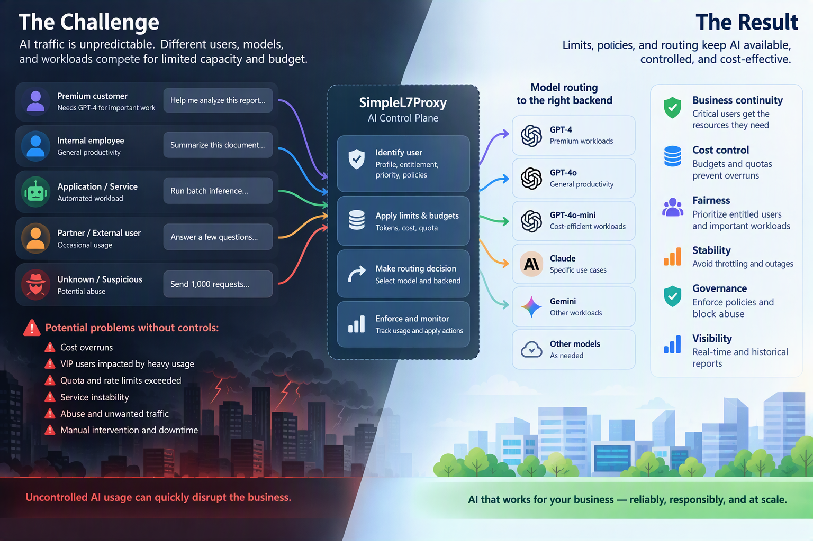
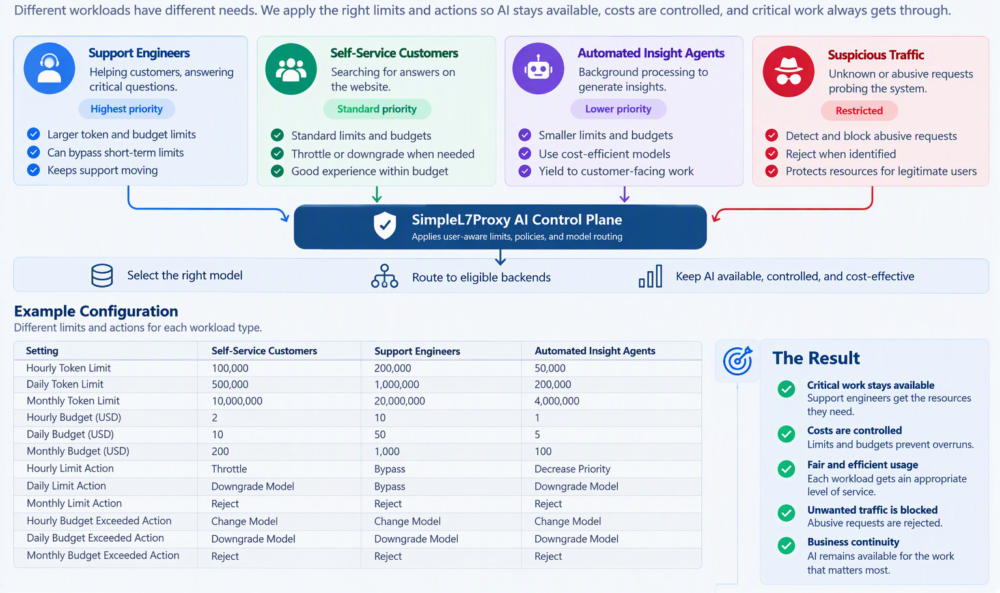

# Tokenomics Scenario: Limits, Budgets, and Actions

This scenario illustrates how a fictional company can use limits, budgets and actions to help with business continuity.

## Scenario:

SupportWorks relies heavily on AI to help support engineers research documentation and answer customer questions. But those engineers share the same AI resources with automated agents generating insights, customers searching for answers online, and occasionally unknown users probing the system.

These workloads don't have the same business value, yet they compete for the same capacity and budget.

When resources become constrained, SupportWorks needs to protect the work that matters most. Support engineers helping customers should receive priority, self-service users should be routed to an appropriate model while staying within budget, automated workloads can be delayed or moved to lower-cost models, and suspicious traffic can be rejected.

The AI control plane makes those decisions by identifying the workload, applying limits and policies, and routing each request to the appropriate model and backend.

The result is controlled cost and fair use without sacrificing the availability of business-critical AI.

## Tokenomics settings:

SupportWorks has a simple goal: **keep AI available for the work that matters most, while keeping usage and cost under control.**

The plan is:

**First, understand who is making the request and how important the work is.** A support interaction should take priority over background processing, while suspicious traffic should not consume resources intended for legitimate users.

**Second, put limits and budgets around AI consumption.** Instead of allowing one workload to consume all available capacity or budget, SupportWorks defines how much different users and workloads can consume and what should happen when those limits are reached.

**Finally, route each request to the appropriate model and backend.** Important customer-facing work can use higher-capability resources, while less critical or automated workloads can use more cost-efficient options.

SupportWorks configures the AI control plane: **identify the workload, apply limits and policies, then route the request to the right model and backend.**

The result is not simply lower AI usage. The result is **business continuity**: critical work keeps moving, costs remain controlled, and available AI capacity is used where it provides the most value.

-----
# Profiles, Limits, Budgets, Model Routing

We have translated the plan into limits and actions.

Support engineers get the **highest allowances**, self-service gets a **balanced budget**, and automated workloads get **smaller allowances and lower priority**. Abusive traffic is rejected.

When a limit is reached, the response depends on the workload. We can **bypass the limit, throttle the request, change models, reduce priority, or reject it entirely**.

That keeps critical customer-facing work available while controlling AI capacity and cost.

