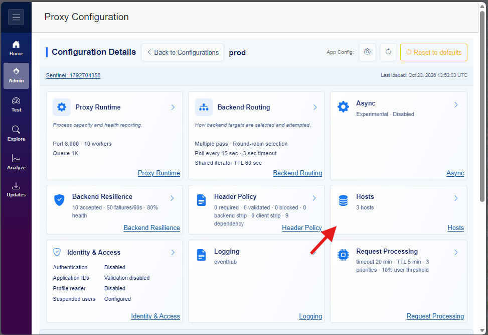
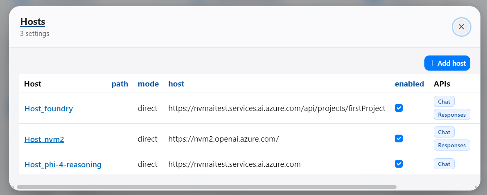
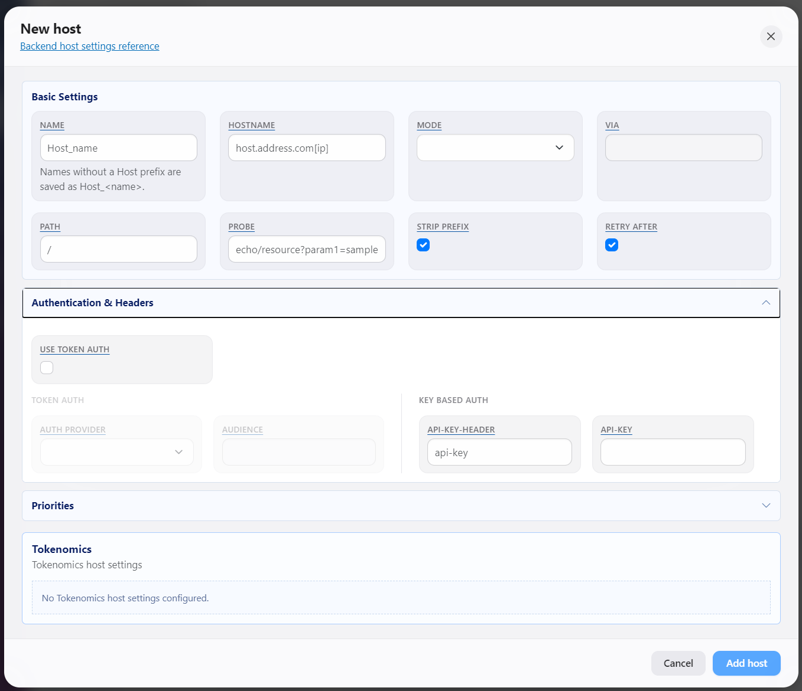
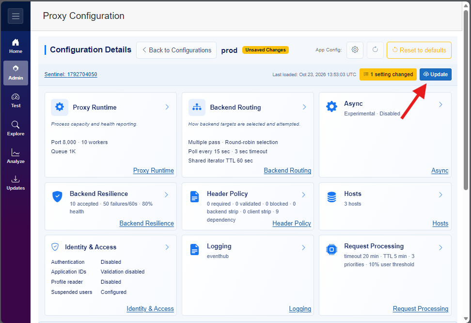

# Adding a Host

Add a backend host in CompanionApp so the proxy can route requests to it.

## TL;DR

- Open **Proxy Configuration** and select **Hosts**.
- Add the backend endpoint and its required connection settings.
- Save the configuration, then assign models and APIs to the host.

## Open Hosts

**Start from the configuration for the proxy you want to update.**

Select **Hosts** to see configured endpoints, modes, enabled states, and APIs.

Select **Add host** to open the host form.

## Enter host settings

**Enter the endpoint and settings needed to connect to your backend.**

Enter a name and hostname, then select the connection mode and configure the path and probe as appropriate. Use **Authentication & Headers** for token or API-key authentication and **Priorities** for priority settings. See [Backend Host Configuration](../reference/backend-hosts.md) for field details and [Configure Backends](../how-to/configure-backends.md) for backend options.

Select **Add host** in the form. The change remains local until you save it from Proxy Configuration.

## Save and continue

**Save the staged configuration before expecting the proxy to use it.**

Return to Proxy Configuration and save the changes. The example shows an **Update** action; the configuration page can also show **Save changes**. Then [assign models and APIs](companionapp-model-routing.md) to the host and [verify the connection](verify.md).

> [!TIP]
> If the backend is not eligible, check its endpoint, connection mode, authentication, and probe settings.

[All CompanionApp visual guides](companionapp-visual-guide.md)
