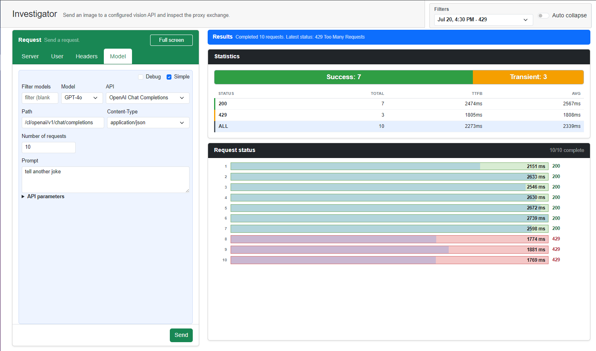

# Testing Requests with Investigator

Send requests through the proxy and inspect their outcomes in CompanionApp.

## TL;DR

- Select a configured model and API.
- Enter a prompt and send requests.
- Review status codes and durations in the results.

## Send and inspect requests

**Use Investigator to compare the outcomes of requests sent through the proxy.**

Choose a model and API, enter a prompt, set the number of requests, and select **Send**. The results show a status and duration for each request and summarize successful responses and transient failures.

> [!TIP]
> If requests fail, check the proxy connection and the model's host and API assignments. Use [Inspecting Request Details](companionapp-request-details.md) to follow captured events.

[All CompanionApp visual guides](companionapp-visual-guide.md)
