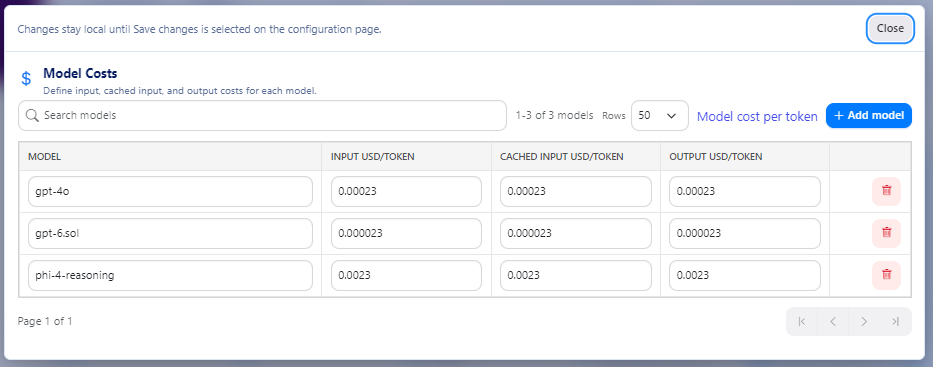

# Setting Model Prices

Set model prices in CompanionApp for cost reporting.

## TL;DR

- Open **Model Costs** in Proxy Configuration.
- Enter the model's input, cached-input, and output prices.
- Save the configuration to publish the prices.

## Enter prices

**Use prices that correspond to the model and its provider's pricing.**

Open **Model Costs** in the Tokenomics section.

Enter prices for the model's input, cached input, and output. The example displays USD per token; use the editor's unit selection when entering prices.

## Save prices

**Prices support cost reporting; they do not configure backend credentials or endpoints.**

Close the editor and select **Save changes** on the configuration page to publish the staged changes.

> [!TIP]
> If cost reporting is incomplete, check that prices are configured for the model and that usage telemetry is available. See [Exploring Tokenomics Reports](companionapp-tokenomics-reports.md).

[All CompanionApp visual guides](companionapp-visual-guide.md)
