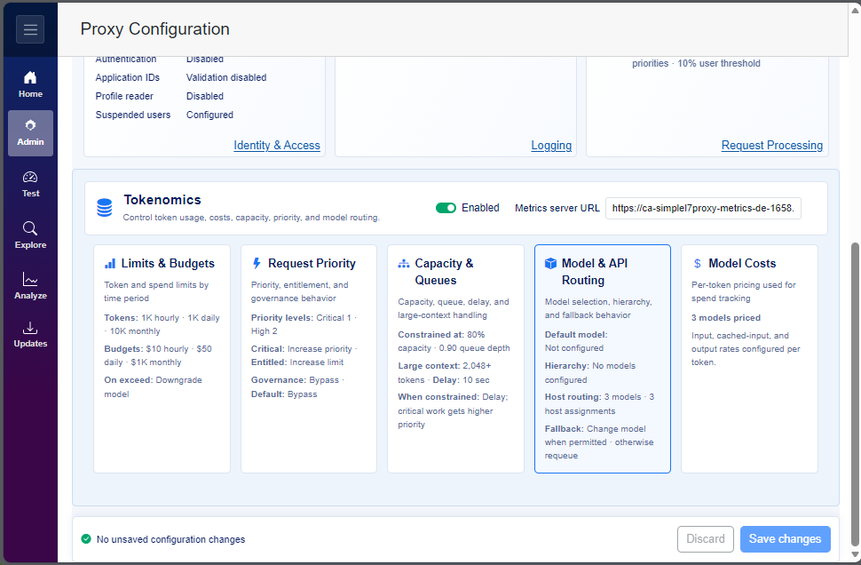
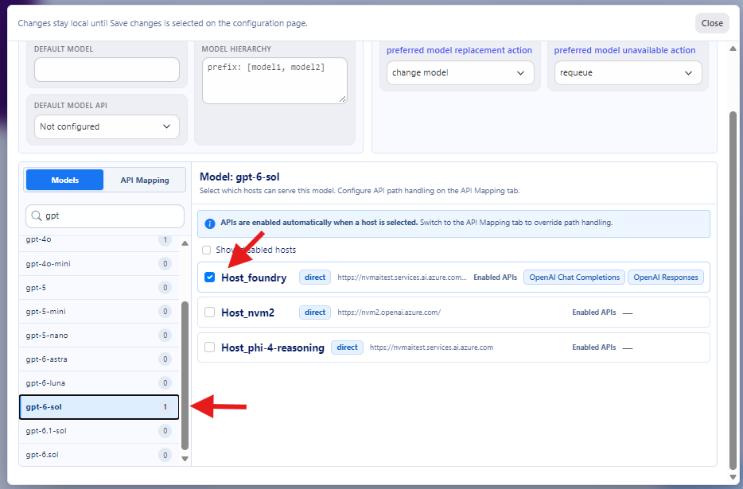

# Assigning Models and APIs

Choose which hosts can serve each model and configure their API paths in CompanionApp.

## TL;DR

- Open **Model & API Routing** in Proxy Configuration.
- Select a model and the hosts that can serve it.
- Review API path handling and save the configuration.

## Select a model and host

**Each model-host assignment identifies a host that can serve that model.**

Open **Model & API Routing** in the Tokenomics section.

On the **Models** tab, select a model and select the hosts that can serve it. The selected host displays its enabled APIs.

## Review API paths and save

**Use API Mapping to configure how each assigned host handles an API path.**

Review the **API Mapping** tab when a host needs a path override. Close the editor and select **Save changes** on the configuration page to publish the staged changes.

> [!TIP]
> If a model cannot be routed to a host, check the host's enabled state and its model and API assignments. See [Adding a Host](companionapp-add-host.md) and [Backend Host Configuration](../reference/backend-hosts.md).

[All CompanionApp visual guides](companionapp-visual-guide.md)
