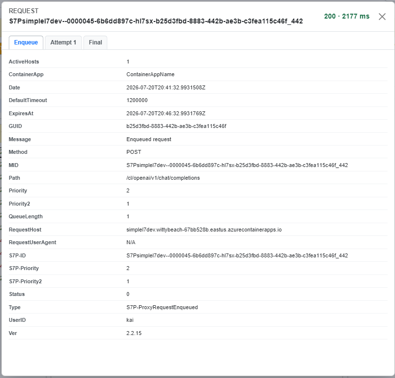
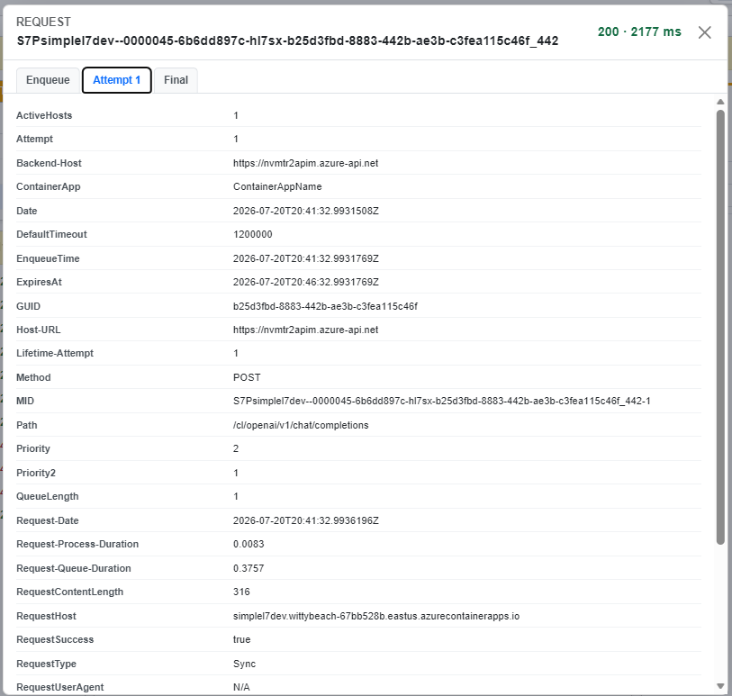
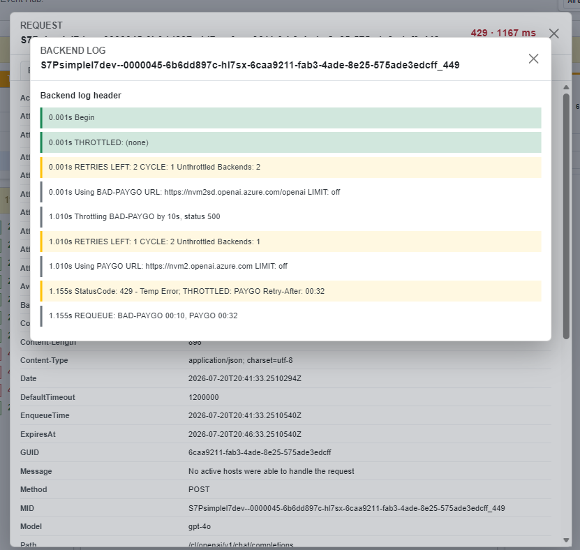

# Inspecting Request Details

Follow a captured request from enqueue through backend attempts to its final outcome.

## TL;DR

- Inspect the enqueue event for request and queue details.
- Review each recorded backend attempt.
- Check the final outcome and backend log when available.

## Follow the request

**Read the events together to understand how the request was processed.**

The Enqueue view shows the request as it entered the queue, including its path, priority, queue length, and request identity fields.

An Attempt view shows backend-specific details such as the selected host, attempt number, request timing, and success status.

The final view shows the terminal request outcome. When available, the backend log explains the attempts and response handling that led to that outcome.

> [!TIP]
> If an event or backend log is missing, check which telemetry was captured for the request before drawing conclusions about its processing.

[All CompanionApp visual guides](companionapp-visual-guide.md)
