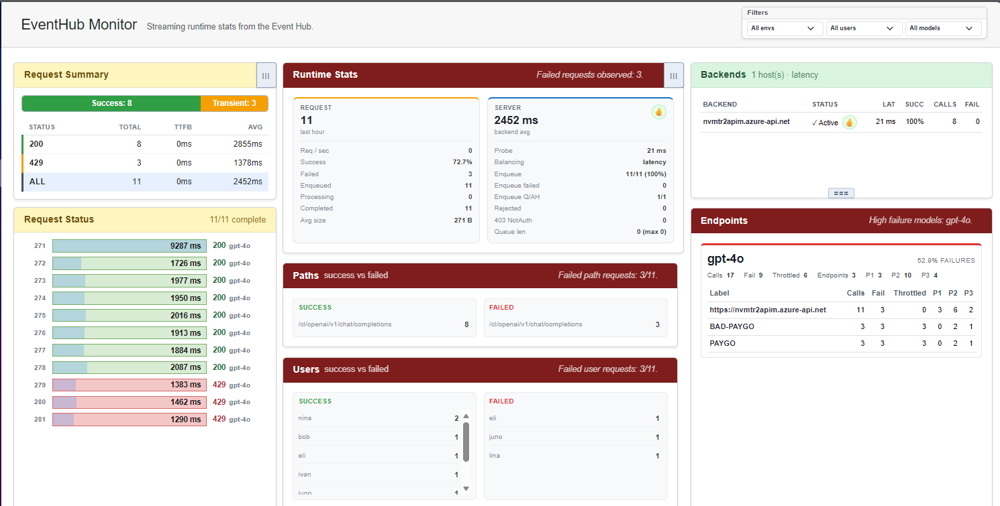
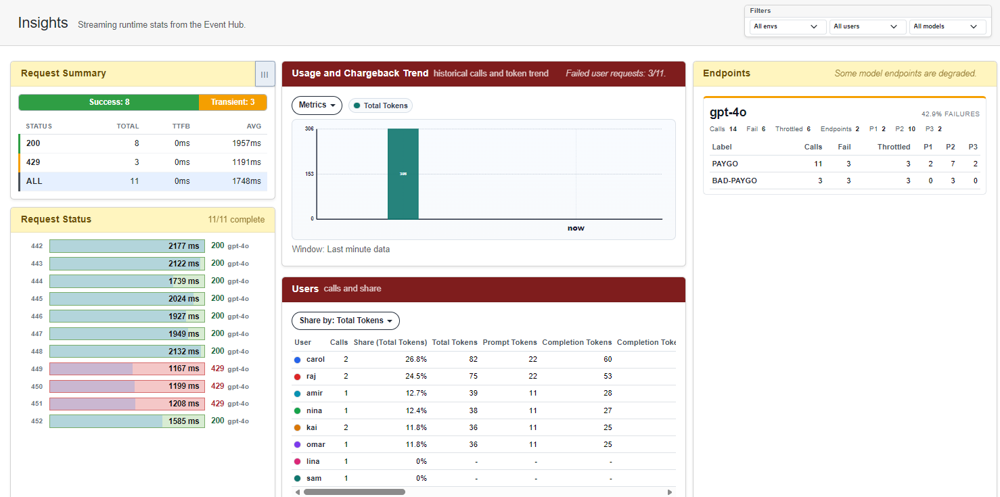

# Monitoring Runtime Activity

Review runtime activity and usage summaries in CompanionApp.

## TL;DR

- Use Event Hub Monitor to inspect received runtime events.
- Use Insights to review usage and chargeback summaries.
- Narrow the displayed activity with the available filters.

## Monitor events and usage

**Use the monitor and Insights together to understand recorded runtime activity.**

Event Hub Monitor presents runtime summaries for events it receives, including request outcomes, enqueue and processing counts, path and user breakdowns, and backend status.

Insights presents usage and chargeback summaries alongside request outcomes and endpoint activity. Use the filters to narrow the displayed environment, user, or model.

> [!TIP]
> If a view is empty, check its filters and whether the deployment is receiving the expected telemetry. See [Observability and telemetry concepts](../concepts/observability.md).

[All CompanionApp visual guides](companionapp-visual-guide.md)
