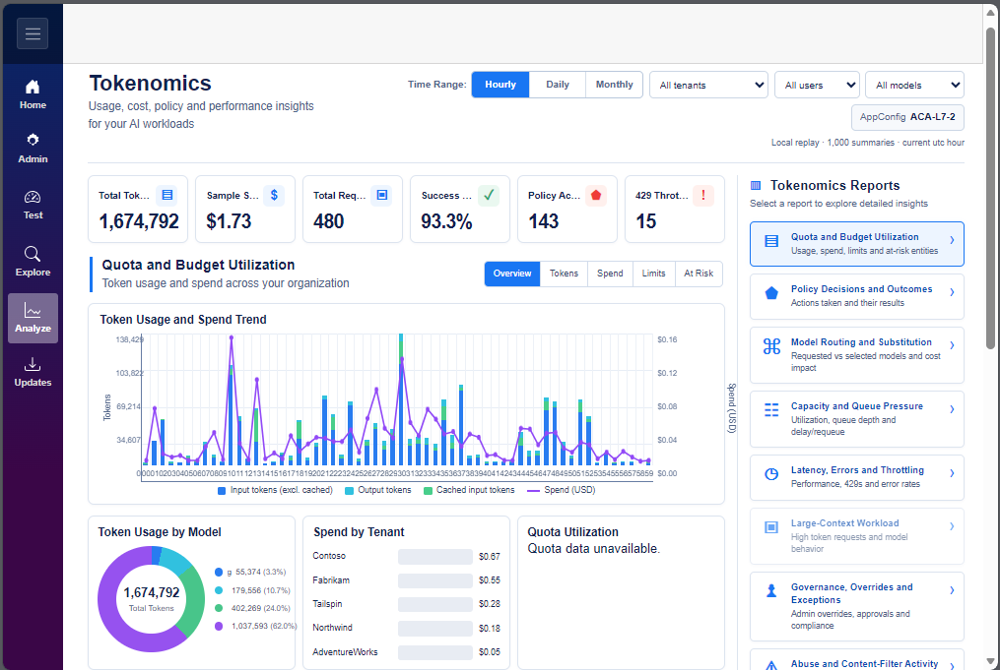
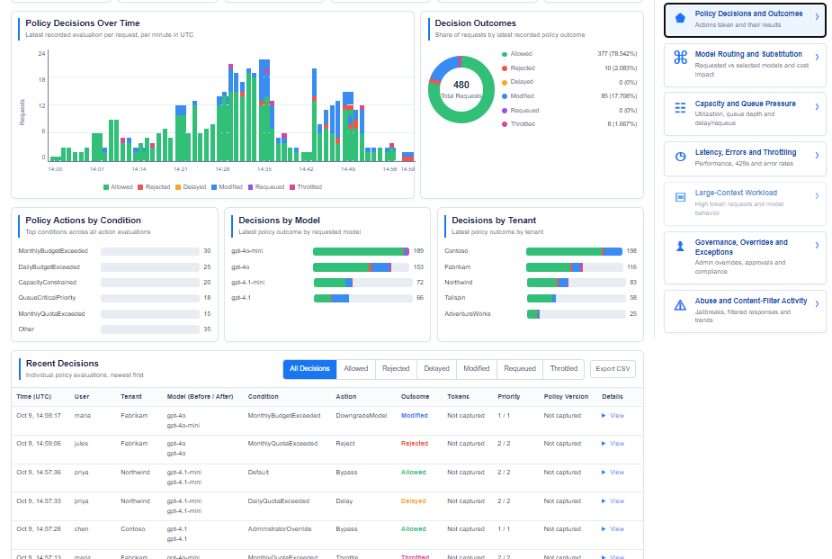
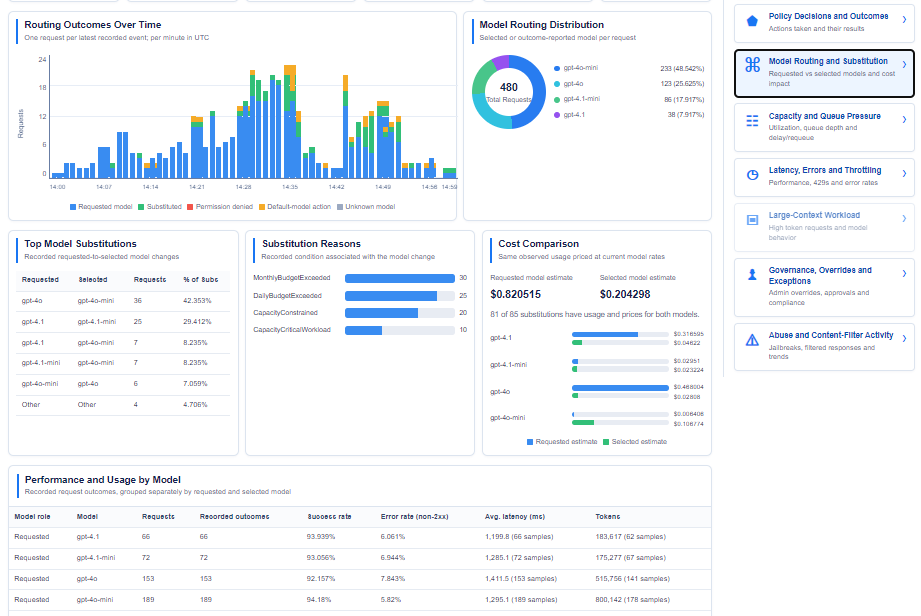
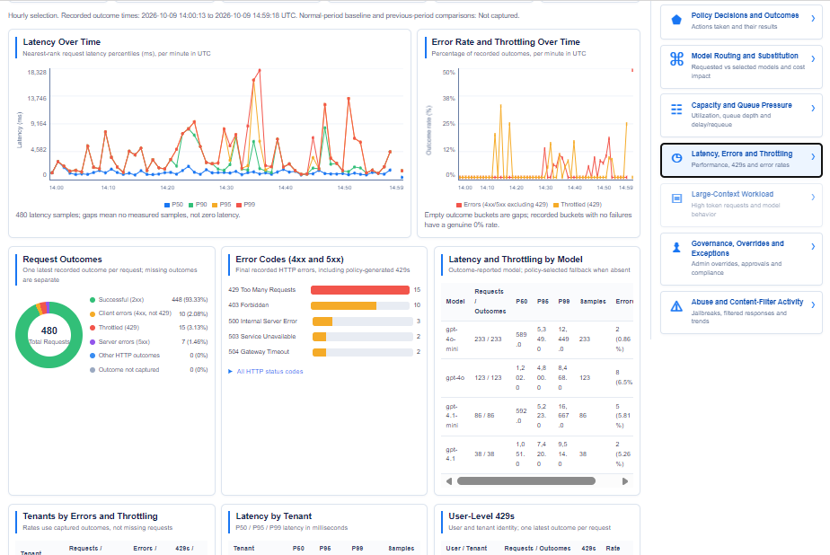
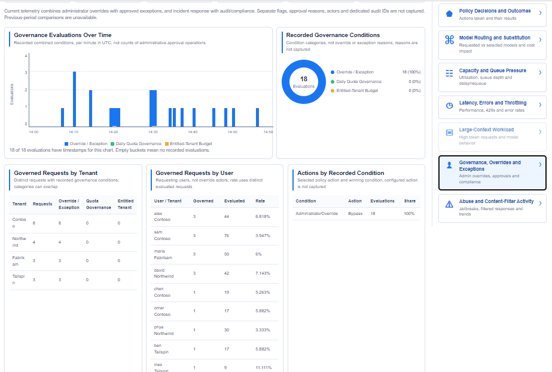
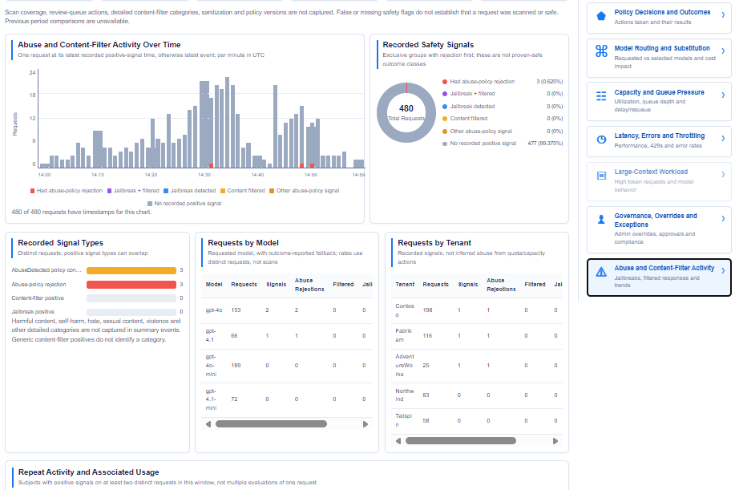

# Exploring Tokenomics Reports

Explore recorded usage, policy decisions, routing, performance, governance, and safety activity in Tokenomics.

## TL;DR

- Select a time range and filters to focus the reports.
- Use the reports to investigate usage, decisions, routing, and outcomes.
- Interpret results in the context of the telemetry captured.

## Usage and policy

**Use utilization and policy reports to understand consumption and recorded evaluations.**

The utilization report summarizes token usage and spend over the selected time range. Its filters and tabs change the view; charts and totals reflect events available to the report.

The policy report groups recorded evaluations by outcome, condition, model, and tenant. Its recent-decisions table provides row-level detail; fields that telemetry does not capture are unavailable rather than inferred.

## Routing and performance

**Compare recorded routing decisions with request latency and HTTP outcomes.**

The routing report compares requested and selected models and displays recorded substitutions and estimated cost comparisons where the required usage and pricing data are available.

The performance report shows recorded latency distributions and HTTP outcomes, including 429 throttles. Empty portions of a time series indicate no recorded samples for that interval.

## Governance and safety

**Read governance and safety reports as records of captured signals, not proof of unrecorded actions.**

The governance report summarizes evaluations matching its recorded categories. It is not an audit of approvals or policy details that were not captured in telemetry.

The safety report shows recorded positive signals and associated activity. Missing signals mean no positive signal was recorded; they do not prove that a request was scanned or safe.

> [!TIP]
> If a report is empty or incomplete, check its filters and the telemetry received for the selected time range.

[All CompanionApp visual guides](companionapp-visual-guide.md)
