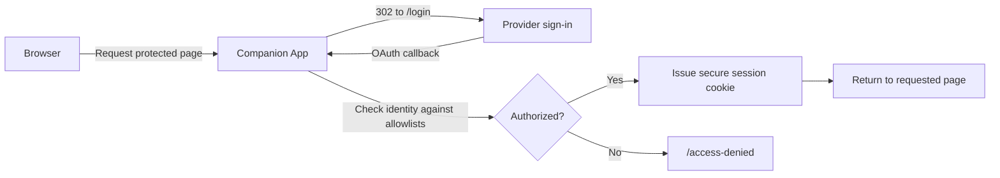

# Configure Companion App Authentication

Companion App exposes configuration and deployment features. Until authentication is enabled, anyone who can reach the service can use them.

Choose one provider:

| Provider | Use when | How access works |
|---|---|---|
| `Github` | Users have GitHub identities (developer or open-source deployments). | Browser sign-in → session cookie. Allowlist by user, org, or team. |
| `Google` | Users belong to a Google Workspace domain. | Browser sign-in → session cookie. Allowlist by email or domain. |
| `OAuth2` | A machine caller already has a signed JWT. | Each request carries `Authorization: Bearer <jwt>`. No browser sign-in. |

**Rules that apply to every provider:**

- Keep client secrets in environment variables or Container App secrets. Never put them in source control.
- Register the exact callback URL. In Container Apps, use the public HTTPS URL, not the internal HTTP address.
- Authentication settings are read at startup. Restart the app after changing them. In Container Apps, changing environment variables creates a new revision, which restarts the app.

> [!WARNING]
> While `Enabled` is `false`, all other authentication settings are ignored. Companion App shows a warning, and the service is open to anyone who can reach it. Do not expose an unauthenticated deployment to an untrusted network.

## How Browser Sign-In Works (GitHub and Google)



The provider sends the user back to a callback URL that Companion App builds from the incoming request:

| Provider | Default callback path |
|---|---|
| GitHub | `/signin-github` |
| Google | `/signin-google` |

Behind Azure Container Apps ingress, the container listens on internal HTTP port `8080`, but the callback must use the public `https` host. Companion App reads the `X-Forwarded-Proto` and `X-Forwarded-Host` headers from ingress to build the public URL.

**Example:** host `https://companion.example.com`, GitHub provider.

| Step | What happens |
|---|---|
| 1 | The browser requests `https://companion.example.com/login`. |
| 2 | Companion App sends the user to GitHub with callback `https://companion.example.com/signin-github`. |
| 3 | GitHub returns user `octocat`. Companion App checks `octocat` against its allowlists. |
| 4 | `AllowedUsers__0=octocat` matches, so a secure session cookie is issued. |
| 5 | Later requests present the cookie and are served. |

## Configure GitHub

### 1. Create the GitHub OAuth App

1. Open [GitHub Developer settings](https://github.com/settings/developers) → **OAuth Apps** → **New OAuth App**.
2. **Application name:** `CompanionApp`
3. **Homepage URL** and **Authorization callback URL:**

   | Environment | Homepage URL | Authorization callback URL |
   |---|---|---|
   | Local | `http://localhost:5259` | `http://localhost:5259/signin-github` |
   | Container Apps | `https://<companion-host>` | `https://<companion-host>/signin-github` |

4. Leave **Enable Device Flow** off. Companion App does not use it.
5. Register the app, copy the **Client ID**, and generate a **client secret**.

The callback must match exactly: scheme, host, port, and path. You can register only one callback per OAuth App, so create separate OAuth Apps for local and deployed environments.

### 2a. Run Locally

Set the following as environment variables:

```env
CompanionApp__Authentication__Enabled=true
CompanionApp__Authentication__Provider=Github
CompanionApp__Authentication__Github__ClientId=<github-client-id>
CompanionApp__Authentication__Github__ClientSecret=<github-client-secret>
CompanionApp__Authentication__Github__AllowedUsers__0=<github-login>
```

Alternatively, put the non-secret values in `appsettings.Development.json` and keep only the secret in an environment variable:

```json
{
  "CompanionApp": {
    "Authentication": {
      "Enabled": true,
      "Provider": "Github",
      "Github": {
        "ClientId": "<github-client-id>",
        "AllowedUsers": [ "<github-login>" ]
      }
    }
  }
}
```

> [!WARNING]
> Never put the client secret in tracked JSON. If a secret is exposed, revoke it in GitHub and generate a new one.

### 2b. Run in Azure Container Apps

Store the secret, then point to it from an environment variable:

```bash
az containerapp secret set -n <app> -g <rg> \
  --secrets github-client-secret=<github-client-secret>

az containerapp update -n <app> -g <rg> --set-env-vars \
  CompanionApp__Authentication__Enabled=true \
  CompanionApp__Authentication__Provider=Github \
  CompanionApp__Authentication__Github__ClientId=<github-client-id> \
  CompanionApp__Authentication__Github__ClientSecret=secretref:github-client-secret \
  CompanionApp__Authentication__Github__AllowedUsers__0=<github-login>
```

In environment variable names, `__` replaces `:` (`CompanionApp:Authentication:Github:ClientId` becomes `CompanionApp__Authentication__Github__ClientId`). Array entries use consecutive indexes: `__0`, `__1`, `__2`.

### 3. Restrict Who Can Sign In

> [!IMPORTANT]
> If all three allowlists are empty, **any** GitHub account that signs in is accepted. Always configure at least one.

| Allowlist | Example | Notes |
|---|---|---|
| Users | `AllowedUsers__0=octocat` | The login from the profile URL (`github.com/octocat`), not the display name or email. |
| Organizations | `AllowedOrganizations__0=example-org` | Adds the `read:org` scope automatically. |
| Teams | `AllowedTeams__0=example-org/operators` | Format: `org/team-slug`. Adds `read:org` automatically. |

```env
CompanionApp__Authentication__Github__AllowedUsers__0=octocat
CompanionApp__Authentication__Github__AllowedOrganizations__0=example-org
CompanionApp__Authentication__Github__AllowedTeams__0=example-org/operators
```

A user is accepted if their login, **or** any of their organizations, **or** any of their teams matches.

> [!TIP]
> For organization or team allowlists, the organization may need to approve the OAuth App before membership is visible. Require SSO and review OAuth App access in the organization settings.

## Configure Google

1. In Google Cloud, configure the **OAuth consent screen** for the intended users.
2. Create an **OAuth 2.0 Client ID** with type **Web application**.
3. Add an authorized redirect URI:
   - Local: `http://localhost:5259/signin-google`
   - Deployed: `https://<companion-host>/signin-google`
4. Copy the client ID and client secret.

```env
CompanionApp__Authentication__Enabled=true
CompanionApp__Authentication__Provider=Google
CompanionApp__Authentication__Google__ClientId=<google-client-id>
CompanionApp__Authentication__Google__ClientSecret=<google-client-secret>
CompanionApp__Authentication__Google__AllowedUsers__0=user@example.com
CompanionApp__Authentication__Google__AllowedDomains__0=example.com
```

A user is accepted if their email **or** email domain matches. If both lists are empty, **any** Google account is accepted. For Google Workspace, restrict by domain.

Default scopes are `openid`, `profile`, and `email`. To change the callback path, set `Google:CallbackPath`.

## Configure OAuth2 Bearer Tokens

OAuth2 mode validates a signed JWT on every request. It has no browser sign-in: requests to `/login` return `401 Unauthorized`.

```env
CompanionApp__Authentication__Enabled=true
CompanionApp__Authentication__Provider=OAuth2
CompanionApp__Authentication__OAuth2__Issuer=https://issuer.example.com
CompanionApp__Authentication__OAuth2__MetadataAddress=https://issuer.example.com/.well-known/openid-configuration
CompanionApp__Authentication__OAuth2__Audiences__0=api://companion-app
CompanionApp__Authentication__OAuth2__RequiredClaims__roles=CompanionApp.User
```

Callers send:

```http
Authorization: Bearer <signed-jwt>
```

- The metadata address must be an absolute HTTPS URL.
- Signature, issuer, audience, and lifetime are always validated. Do not disable them.
- Use `RequiredClaims` to restrict access. Without it, any valid token for the audience is accepted.

## Configuration Reference

All keys are under `CompanionApp__Authentication__`.

| Setting | Default | Purpose |
|---|---|---|
| `Enabled` | `false` | Turns access enforcement on. |
| `Provider` | `None` | `Github`, `Google`, or `OAuth2`. |
| `LoginUrl` | `/login` | Starts browser sign-in. |
| `LogoutUrl` | `/logout` | Clears the session. |
| `UnauthorizedRedirectUrl` | `/access-denied` | Shown to a signed-in user who fails the allowlists. |
| `PostLogoutRedirectUrl` | `/` | Destination after logout. |
| `SessionTimeoutMinutes` | `60` | Cookie lifetime. |
| `SlidingExpiration` | `true` | Renews the cookie while the user is active. |

## Verify

After a restart, check the startup log for:

```text
Authentication enabled: provider <provider>.
```

Then test access:

```bash
# GitHub or Google: expect 302 to /login
curl -I http://localhost:5259/

# OAuth2: expect 401 without a token, 200 with a valid one
curl -I http://localhost:5259/
curl -I -H "Authorization: Bearer <signed-jwt>" http://localhost:5259/
```

| Result | Expected log or behavior |
|---|---|
| GitHub sign-in succeeds | `User authenticated: <github-login> via GitHub.` |
| Google sign-in succeeds | `User authenticated: <email> via Google.` |
| Bearer token accepted | `User authenticated: <subject> via OAuth2.` |
| Signed in, but not on an allowlist | Redirect to `/access-denied` |
| Unauthenticated warning banner | Appears only when `Enabled=false` |

## Troubleshoot

| Symptom | Cause | Fix |
|---|---|---|
| GitHub: `Invalid Redirect URI` | The registered callback does not exactly match the URL Companion App generated. | Compare scheme, host, port, and `/signin-github`. In Container Apps, use `https`. |
| Callback goes to `http://` in Container Apps | Forwarded headers are missing or stripped. | Confirm ingress sends `X-Forwarded-Proto` and `X-Forwarded-Host`, and that the deployed version honors them. |
| `Access denied` after a successful sign-in | No allowlist matched. | Check the exact GitHub login, `org/team-slug`, or Google email/domain. |
| Any GitHub or Google account can sign in | All allowlists are empty. | Add at least one allowlist entry. |
| Org or team allowlist never matches | The OAuth grant cannot see organization membership. | Approve the OAuth App in the GitHub organization's settings. |
| Startup rejects the GitHub configuration | Client ID or secret is missing. | Check `...Github__ClientId` and `...Github__ClientSecret`. If you use `secretref:`, confirm the secret exists. |
| OAuth2 token rejected | Issuer, audience, signature, or lifetime check failed. | Compare the token's `iss` and `aud` with the configuration, and confirm the metadata URL and signing keys. |
| Redirect loop | Login, callback, or access-denied paths are protected or overlap. | Keep these paths anonymous and distinct. Never set them to `/`. |

## Security Checklist

- [ ] `Enabled=true`, and the startup log shows `Authentication enabled: provider ...`.
- [ ] At least one allowlist (GitHub or Google) or `RequiredClaims` entry (OAuth2) is configured.
- [ ] Client secrets are in Container App secrets or a secret store. Exposed secrets have been revoked.
- [ ] Deployed callbacks use exact HTTPS URLs.
- [ ] The container is reachable only through ingress. If clients can reach it directly, they can fake `X-Forwarded-*` headers.