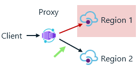
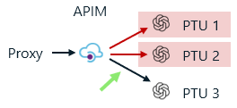
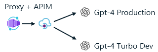
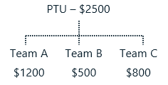
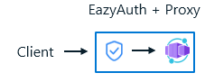
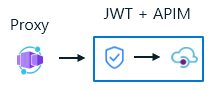

# Proofs of Concept: See the Proxy in Action

Want to see what SimpleL7Proxy actually does? These are hands-on scenarios you can run and watch. Each one proves a single behavior so you can see it, verify it, and explain it.

## Not sure where to start?

- 🔁 **New here?** Start with **Failover** to watch a failed backend hand off to another.
- 🎯 **Care about routing?** Try **Priority Routing** to see APIM honor request priority.
- 🛡️ **Locking things down?** Jump to the **Chargeback** or **Security** scenarios.

## Pick a scenario

<table>
<tr>
<td width="33%" valign="top">

### [🔁 Failover](failover.md)
A failed backend attempt advances to another backend.

</td>
<td width="33%" valign="top">

### [🧠 Capacity Failover](openai-failover.md)
Azure OpenAI capacity fails over across deployments.

</td>
<td width="33%" valign="top">

### [🎯 Priority Routing](priority-routing.md)
APIM backend eligibility follows request priority.

</td>
</tr>
<tr>
<td width="33%" valign="top">

### [💰 Chargeback](chargeback.md)
Usage telemetry gets attributed to the right caller.

</td>
<td width="33%" valign="top">

### [🔒 Secure the Proxy](secure-the-proxy.md)
Proxy ingress rejects unauthorized callers.

</td>
<td width="33%" valign="top">

### [🛡️ Secure APIM](secure-apim.md)
APIM validates callers before forwarding.

</td>
</tr>
</table>

> [!TIP]
> No real model endpoint handy? Use the [LLM Simulator](../how-to/llm-simulator.md) — it's built in and you don't need anything else.
