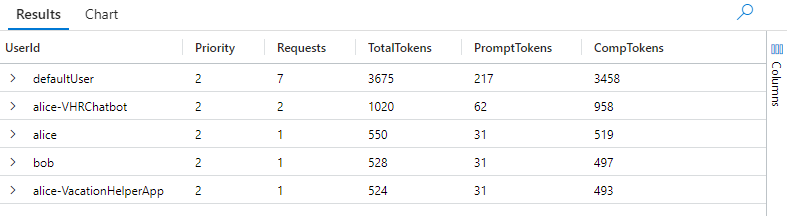
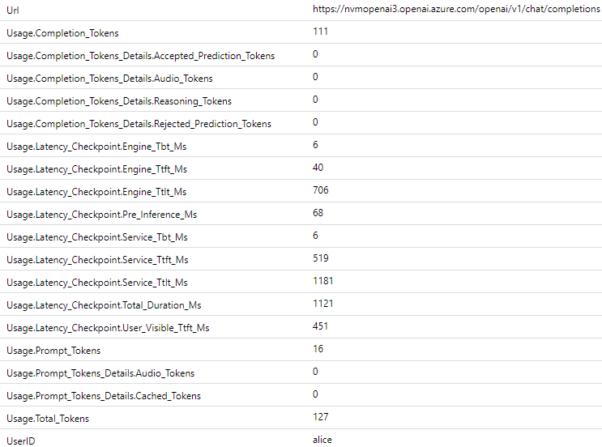

# POC: LLM Chargeback

**Purpose:** Report token consumption in a smart router deployment.

> [!CONCEPT]
> **When you're sharing an endpoint across multiple users or groups, you want to know everyone's share of the usage. The proxy can seamlessly capture the token consumption data and store it in Application Insights or an Event Hub. Once the data is stored, the chargeback can be reported via KQL, SQL, etc.**

## TL;DR

1. The proxy identifies the caller and enriches the request.
2. The proxy captures token usage from each response and logs it.
3. A KQL query confirms that token usage is attributed to each caller.

## What you will observe

The proxy can intercept LLM requests and log metrics in real time to Application Insights. You can then generate chargebacks to usrs or departments based on data from Log Analytics or an alternate sink such as Event Hubs.

## How it works

The proxy identifies the caller, looks up the caller's profile, and enriches the request. It then pairs the response's token metrics with the caller's identity.

The caller's identity can come from the `applicationId` embedded in the OAuth token or from a custom combination of headers. For this POC, we bypass the profile lookup and include `X-UserID` directly in each request.

> [!NOTE]
> A caller can supply any `X-UserID` value. Use a trusted identity mechanism for production chargeback.

---

## Minimal Prerequisites

- A proxy and CompanionApp deployed using the [prebuilt package](../../deployment/README.md).
- An LLM endpoint with a deployed model, such as `gpt-4o`, and credentials to access it.
- A client such as `curl` and access to the deployment's Application Insights resource.

> [!WARNING]
> The prebuilt deployment starts unlocked and publicly accessible. Follow the [deployment guide's security instructions](../../deployment/README.md#secure-the-proxy); do not leave the proxy or CompanionApp unsecured.

---

## Step 1. Configure a backend

Follow [Adding a Host](../getting-started/companionapp-add-host.md) to add your LLM endpoint and its authentication settings in CompanionApp. Select `Tokenomics` as the token metrics processor and save the configuration.

## Step 2. Assign a model and API

Follow [Assigning Models and APIs](../getting-started/companionapp-model-routing.md) to assign your model and API to the host, then save the configuration.

## Step 3. Verify connectivity

Use the proxy URL printed by the deployment and follow [Verify SimpleL7Proxy](../getting-started/verify.md) to confirm readiness. Set the complete URL, including `https://`, for the requests below:

```bash
export PROXYHOST="<proxy-url>"
```

The prebuilt deployment creates Application Insights and configures its connection string. Telemetry may take time to appear.

---

## Step 4. Send a request to confirm the pipeline is working.

Depending on your scenario, the URL and body will differ. Define `URL` and `BODY` for your test endpoint.

```bash
# OpenAI - gpt-4o
export URL="openai/v1/chat/completions"
export BODY='{"model":"gpt-4o","messages":[{"role":"user","content":"hello"}],"stream":false}'
```

Now that `$PROXYHOST`, `URL`, and `BODY` are defined, run the following command to get a response. Add the credentials required by your proxy's access controls.

```bash
# Make the call
curl -i -H "X-UserID: alice" \
  -H "Content-Type: application/json" -d "$BODY" "$PROXYHOST/$URL"
```

---

## Verifying the first pass

The proxy writes a `requests` entry to Application Insights for every completed request, with token counts in `customDimensions`.

The queries below use OpenAI field names. For Anthropic or Gemini, substitute the field names from the [provider table](#reference).


Open **Logs** in the deployment's Application Insights resource, then run:

```kusto
requests
| where timestamp > ago(1h)
| where customDimensions contains "Usage.Total_Tokens"
| project
    timestamp,
  UserId       = tostring(coalesce(customDimensions["UserID"], customDimensions["userID"])),
  Priority     = tostring(coalesce(customDimensions["S7P-Priority"], customDimensions["S7P_Priority"])),
  Backend      = tostring(coalesce(customDimensions["BackendHost"], customDimensions["Backend-Host"])),
  PromptTokens = toint(coalesce(customDimensions["Usage.Prompt_Tokens"], customDimensions["Usage.Input_Tokens"])),
  CompTokens   = toint(coalesce(customDimensions["Usage.Completion_Tokens"], customDimensions["Usage.Output_Tokens"])),
    TotalTokens  = toint(customDimensions["Usage.Total_Tokens"])
| summarize
    Requests     = count(),
    TotalTokens  = sum(TotalTokens),
    PromptTokens = sum(PromptTokens),
    CompTokens   = sum(CompTokens)
    by UserId, Priority
| order by TotalTokens desc
```

The results show request and token totals by user and priority. If the query shows a `UserId` and counts for the usage fields, the full pipeline is working.



Depending on the model, there may be additional usage fields worth reporting.

For example, for `gpt-5.4-mini`, these are available in custom dimensions:



---

### Send more data

For a chargeback test across multiple users, send the batch below before running the queries:

```bash
for i in {1..3}; do
  curl -i \
    -H "X-UserID: bob" \
    -H "Content-Type: application/json" -d "$BODY" "$PROXYHOST/$URL"
done
```
After a few minutes, rerun the query above. The example below shows 1 request for `alice` from Step 4 and 3 for `bob` from the batch above. Token counts and priorities depend on the responses and configuration.

| UserId | Priority | Requests | TotalTokens | PromptTokens | CompTokens |
|--------|----------|----------|-------------|--------------|------------|
| bob    | 1        | 3        | 3174        | 174          | 3000       |
| alice  | 1        | 1        | 1058        | 58           | 1000       |

To break down by backend (useful when multiple deployments serve different tiers):

```kusto
requests
| where timestamp > ago(1h)
| where customDimensions contains "Usage.Total_Tokens"
| summarize
    TotalTokens = sum(toint(customDimensions["Usage.Total_Tokens"])),
    Requests    = count()
  by UserId = tostring(coalesce(customDimensions["UserID"], customDimensions["userID"])),
     Backend = tostring(coalesce(customDimensions["BackendHost"], customDimensions["Backend-Host"]))
| order by TotalTokens desc
```

---

## Send data to additional sinks

Set `EVENT_LOGGERS` to one or more of `eventhub`, `file`, or a supported custom logger (comma-separated). Application Insights is configured separately with `APPINSIGHTS_CONNECTIONSTRING`. See [CONFIGURATION_SETTINGS.md](../reference/configuration.md) for all options.

<details>
<summary>Event Hubs</summary>

Set `EVENT_LOGGERS=eventhub` and `EVENTHUB_CONNECTIONSTRING` to enable the Event Hubs sink. The proxy emits the same JSON envelope it writes to the file log; usage fields are present when extracted from the response.

**Capture to a storage account:** Enable the Event Hubs Capture feature on the hub to land events as Avro files in Azure Blob Storage automatically. This gives you a durable, queryable archive without building a consumer.

**Query with ADX (Azure Data Explorer):** Connect ADX to the hub or to the captured Blob Storage container using an external table or continuous ingestion. Once the data is in ADX you can run the equivalent chargeback query:

```kusto
ProxyEvents
| where UsageTotalTokens > 0
| summarize
    Requests    = count(),
    TotalTokens = sum(UsageTotalTokens),
    PromptTokens = sum(UsagePromptTokens),
    CompTokens  = sum(UsageCompletionTokens)
    by UserId, Priority
| order by TotalTokens desc
```

Other tools that work directly with Event Hubs or Blob-captured data include Fabric Real-Time Intelligence, Stream Analytics, and Azure Synapse.

</details>

<details>
<summary>Local File</summary>

Set `EVENT_LOGGERS=file` to write token data to `eventslog.json` for a quick local check before querying Application Insights.

If the proxy is deployed to Azure Container Apps, the file is written inside the container. Use the ACA console to inspect it: in the Azure portal, open the container app → **Containers** → **Console**, then run the `jq` command below. For a more durable setup, ACA supports mounting an Azure Files share as a volume — configure a storage mount in the container app and set the proxy's working directory to that path so `eventslog.json` persists across container restarts.

```bash
cat eventslog.json | jq 'select(."Usage.Total_Tokens" != null) | {"user": .userId, "total": ."Usage.Total_Tokens", "backend": .BackendHost}'
```

Expected output per OpenAI request:
```json
{
  "user": "alice",
  "total": "1058",
  "backend": "https://<funcapp>.azurewebsites.net"
}
```

</details>

<details>
<summary>None</summary>

Set `EVENT_LOGGERS=none` to disable ProxyEvent sinks. Requests are still proxied normally; Application Insights remains a separate telemetry channel.

</details>

---

## Tuning and Further Exploration

Once the basic data is confirmed, these variations are worth trying:

<details>
<summary>Stream Analytics + Power BI dashboard</summary>

With `EVENT_LOGGERS=eventhub`, every request event lands in the hub in real time. Connect an Azure Stream Analytics job to the hub and project the token fields into an output — a Power BI streaming dataset works well here. You can build a live dashboard showing token consumption by user, priority tier, and backend, updating as requests arrive. This is the closest thing to a real-time chargeback view without any custom code.

For a batch approach, use the Event Hubs Capture output (Avro files in Blob Storage) as a Power BI dataflow source, or import it into a Fabric lakehouse for scheduled reporting.

</details>

<details>
<summary>Add a second backend by tier</summary>

Use `acceptablePriorities` to route priority-1 to a "premium" backend and priority-3 to a "standard" one. The `BackendHost` dimension in telemetry then lets you split cost by tier automatically in any of the queries above.

</details>

<details>
<summary>Increase concurrency</summary>

Raise `Workers` and send a larger burst. Watch `eventslog.json` — requests with usage data should have a `Usage.Total_Tokens` entry. Missing usage may mean the response did not include it or the configured processor did not recognize its schema.

</details>

---

## Reference

<details>
<summary>Settings, values, units, and when each takes effect</summary>

| Setting | Value in this POC | Unit | Set in | Takes effect |
| :--- | :--- | :--- | :--- | :--- |
| `processor=` | `Tokenomics` | — | Host settings in CompanionApp | configuration refresh |
| `X-UserID` header | caller-supplied string | — | request header | per request |
| `APPINSIGHTS_CONNECTIONSTRING` | App Insights connection string | — | env var | proxy restart |
| `EVENT_LOGGERS` | `eventhub`, `file`, `none`, or supported custom logger (comma-separated) | — | env var | proxy restart |

> [!NOTE]
> For APIM topology, the `TOKENPROCESSOR` response header can select the processor per response.

</details>

<details>
<summary>LLM Simulator</summary>

Use the [LLM Simulator](../../test/LLMSimulator/Readme.md) instead of the Azure OpenAI endpoint.

Choose the URL and body for the provider you want to simulate:

```bash
# OpenAI
export URL="api/v1/chat/completions"
export BODY='{"model":"gpt-4o-mini","messages":[{"role":"user","content":"hello"}],"stream":true}'

# Gemini
export URL="v1beta/models/gemini-2.5-pro:generateContent"
export BODY='{"contents":[{"role":"user","parts":[{"text":"hello"}]}]}'

# Anthropic
export URL="anthropic/v1/messages"
export BODY='{"model":"claude-sonnet-3-5","messages":[{"role":"user","content":"hello"}]}'
```

The simulator returns token usage with fixed OpenAI counts (58 prompt / 1000 completion / 1058 total). Missing usage entries are rare with the simulator.

</details>

<details>
<summary>Custom dimensions by provider</summary>

The `processor=` value on the backend host determines which usage fields are extracted:

| Provider | `processor=` value | Usage fields logged |
|----------|--------------------|---------------------|
| Supported JSON/SSE providers | `Tokenomics` | Normalized usage fields, cached-input tokens, and available safety signals |
| Azure OpenAI / OpenAI (legacy processor) | `OpenAI` | `Usage.Prompt_Tokens`, `Usage.Completion_Tokens`, `Usage.Total_Tokens` |
| Anthropic (legacy processor) | `AllUsage-2` | `Usage.Input_Tokens`, `Usage.Output_Tokens` |
| Google Gemini (legacy processor) | `MultiLineAllUsage` | `Usage.PromptTokenCount`, `Usage.CandidatesTokenCount`, `Usage.TotalTokenCount` |

Every request also includes: `S7P_RequestId` (correlation ID), `S7P_Priority` (queue assigned), `BackendHost` (URL that served the request).

</details>

## Related Documentation

- [Run SimpleL7Proxy Locally](../getting-started-developer/README.md) — Running the proxy locally for the first time
- [Container Deployment](../getting-started/container-apps.md) — Deploying to Azure Container Apps
- [CONFIGURATION_SETTINGS.md](../reference/configuration.md) — Full reference for all environment variables
- [POC-Priority-configuration.md](priority-routing.md) — Routing requests across backends by priority tier
- [POC-Failover-configuration.md](failover.md) — Automatic failover and retry behaviour when a backend is slow or unavailable
- [OBSERVABILITY.md](../concepts/observability.md) — Token metrics, telemetry channels, and event logger configuration
- [BACKEND_HOSTS.md](../reference/backend-hosts.md) — `processor=` and other host connection string options
