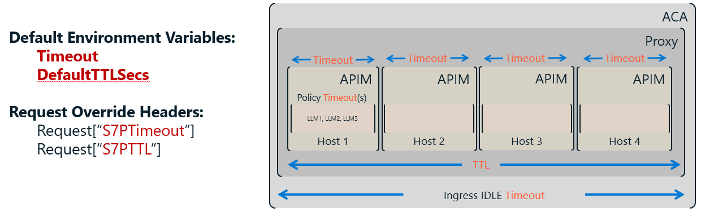
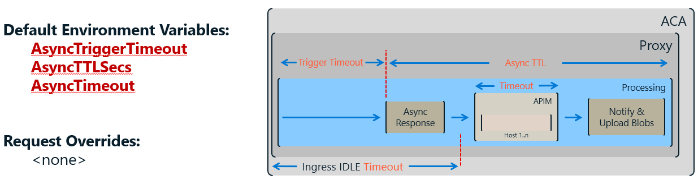

# Timeouts

SimpleL7Proxy uses a request TTL and a per-attempt backend timeout. Async-enabled requests use `AsyncTimeout` for each backend attempt; the TTL is checked separately before an attempt.

> **TL;DR**
> - **Earliest expiration wins** — when TTL and Timeout both apply, whichever deadline arrives first is the one that fires.
> - **TTL** (seconds) is the hard wall-clock budget for the whole request: queue wait + every retry attempt.
> - **Timeout** (milliseconds) is the window for a single host attempt, and it resets on every retry.
> - **AsyncTimeout** (milliseconds) is the per-attempt cancellation window for async-enabled requests, including before the 202 response is sent.

---

> **Heads up on units:** TTL values are in **seconds**; every Timeout value is in **milliseconds**.

## All the Settings at a Glance

| Setting | Default | Unit | Override Header | Config Key | Reload |
|---|---|---|---|---|---|
| **DefaultTTLSecs** | 300 (5 min) | s | `S7PTTL` | `Priority:DefaultTTLSecs` | WARM |
| **Timeout** | 1,200,000 (20 min) | ms | `S7PTimeout` | `Request:DefaultTimeout` | WARM |
| **AsyncTriggerTimeout** | 10,000 (10 s) | ms | — | `Async:TriggerTimeout` | WARM |
| **AsyncTimeout** | 1,800,000 (30 min) | ms | — | `Async:Timeout` | WARM |
| **AsyncTTLSecs** | 86,400 (24 h) | s | — | `Async:TTLSecs` | WARM |

---

## How a Request Flows

Here's the whole picture — both the synchronous and async paths in one diagram. Every clock starts ticking the moment the request is **enqueued**.

```
Client
  │
  ▼  enqueue  ◄─── TTL clock starts (DefaultTTLSecs or S7PTTL)
  │
  ├── AsyncTriggerTimeout elapsed and upgrade eligible? ──Yes──► Return async response (blob URIs) to client
  │                                         Async-enabled attempts use AsyncTimeout
  │                                         Recalculate expiration under AsyncTTLSecs,
  │                                         unless S7PTTL was supplied
  No (synchronous path)
  │
  ▼
  ┌──────────────┐  fail / timeout   ┌──────────────┐  fail / timeout   ┌──────────────┐
  │   Host 1     │ ─────────────────►│   Host 2     │ ─────────────────►│   Host n     │
  │ [Timeout ms] │                   │ [Timeout ms] │                   │ [Timeout ms] │
  └──────────────┘                   └──────────────┘                   └──────────────┘
       ▲                                                                       │
       └───────── TTL expired anywhere along this chain → 412, no retry ───────┘
  │
  ▼
Response to client
```

**On every host attempt, the effective deadline is whichever is smaller: the remaining TTL or the Timeout.**

---

## Synchronous Requests

Each host attempt gets a fresh Timeout window, but no matter how many attempts you make, the total request life is still capped by TTL.



```
DefaultTTLSecs: 60     → ExpiresAt = enqueue + 60 s
Timeout:        45000  → per-host window = 45 s
First attempt:  min(60 s, 45 s) = 45 s effective
```

> [!NOTE]
> **Defaults:** `DefaultTTLSecs = 300 s` and `Timeout = 1,200,000 ms`. These kick in whenever no override headers are present.

> [!TIP]
> **Requests expiring sooner than you expect?** Check that the client isn't sending a short `S7PTTL` header — it silently overrides `DefaultTTLSecs`.

---

## Async Requests

**Use async mode when the caller cannot keep its connection open for the full backend operation.** For an eligible request, the proxy can return **202 Accepted** with result-blob URIs after `AsyncTriggerTimeout`; async-enabled backend attempts use `AsyncTimeout`. A 202 means work continues, not that the result is ready. The upgrade also depends on response timing and blob queue pressure.

Async requires `AsyncModeEnabled` and an available blob writer, valid enabled `async-config` in the selected user profile, and a request opt-in header parsed as `true` (`S7PAsyncMode` by default). Response timing and blob queue pressure also affect whether the proxy upgrades the request. The user profile selects result storage and the Service Bus topic used for lifecycle notifications.

The 202 response body and `x-Data-Blob-URI` / `x-Header-Blob-URI` headers identify the result blobs. The data is written as background work completes; blob deletion is controlled by storage lifecycle policy, not the request TTL. See [Async Processing](../concepts/async-processing.md) for setup and the retrieval workflow.



```
AsyncTriggerTimeout: 10000    → eligibility for an async upgrade begins after 10 s
AsyncTimeout:        1800000  → each async-enabled backend attempt has a 30 min cancellation window
AsyncTTLSecs:        86400    → default TTL used when async expiration is recalculated
```

> [!NOTE]
> **There are no per-request header overrides for async settings.** Configure them through environment variables or App Configuration according to each setting's reload mode. A supplied `S7PTTL` remains in effect; a relative TTL is measured from enqueue.

> [!TIP]
> **Background work finishing too early?** Check the per-attempt `AsyncTimeout` and the request TTL. **No async upgrade?** Check the blob writer, enabled profile settings, request header, response timing, and blob queue pressure.

---

## Overriding Timeouts Per Request

Want different limits for a single request? Send an `S7PTTL` (seconds) or `S7PTimeout` (milliseconds) header and it replaces the global default for that one request.

```http
S7PTimeout: 60000   # per-host timeout → 60 s for this request
S7PTTL: 120         # TTL → 120 s for this request
```

> [!NOTE]
> **Leave a header off and you get the default.** If an override header is absent, the proxy falls back to the corresponding global config value.

> [!WARNING]
> **Watch the format:** an `S7PTTL` value the proxy can't parse returns **400 Bad Request** with error code `InvalidTTL`.

The `S7PTTL` header accepts any of these formats:

| Format | Example | Meaning |
|---|---|---|
| Relative integer | `300` | Expires 300 s from enqueue |
| Relative decimal | `2.5` | Expires 2,500 ms from enqueue |
| Absolute Unix timestamp | `+1735689600` | Expires at the given epoch second |
| ISO 8601 datetime | `2024-12-31T23:59:59Z` | Expires at the given UTC time |

---

<details>
<summary>Worked Example</summary>

Let's walk through a concrete case so you can see the two deadlines racing each other.

> **Scenario:** `DefaultTTLSecs = 60`, `Timeout = 45000`. No override headers. The request queues for 5 s, then needs two host attempts.

| Event | Wall clock | TTL remaining | Host window | Effective deadline | Outcome |
|---|---|---|---|---|---|
| Enqueue | 0 s | 60 s | — | — | TTL clock starts |
| Dequeue | 5 s | 55 s | 45 s | **min(55 s, 45 s) = 45 s** | Attempt Host 1 |
| Host 1 timeout | 50 s | 10 s | 45 s elapsed | — | Retry |
| Host 2 attempt | 50 s | 10 s | 45 s window | **min(10 s, 45 s) = 10 s** | Attempt Host 2 |
| TTL expires | 60 s | 0 s | — | — | 503 — no more retries |

**Notice that on the second attempt it was the TTL — not the per-host Timeout — that set the deadline.**

</details>
